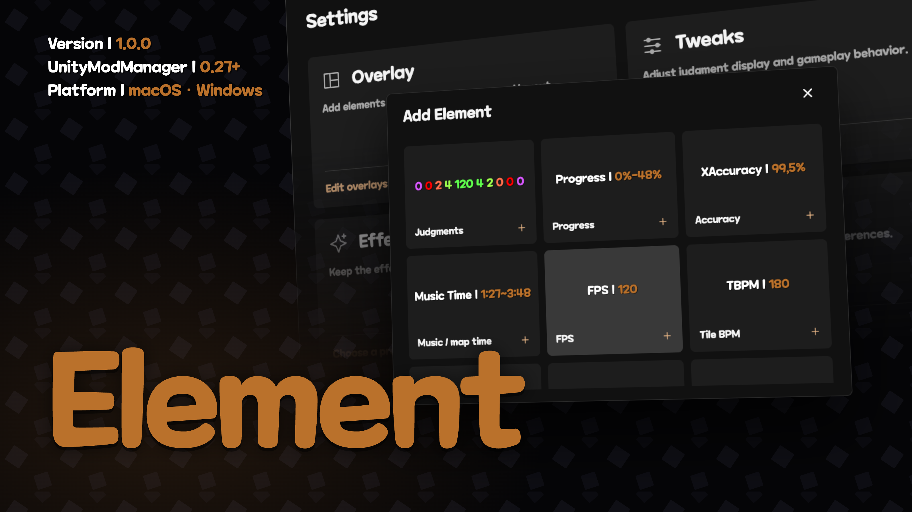
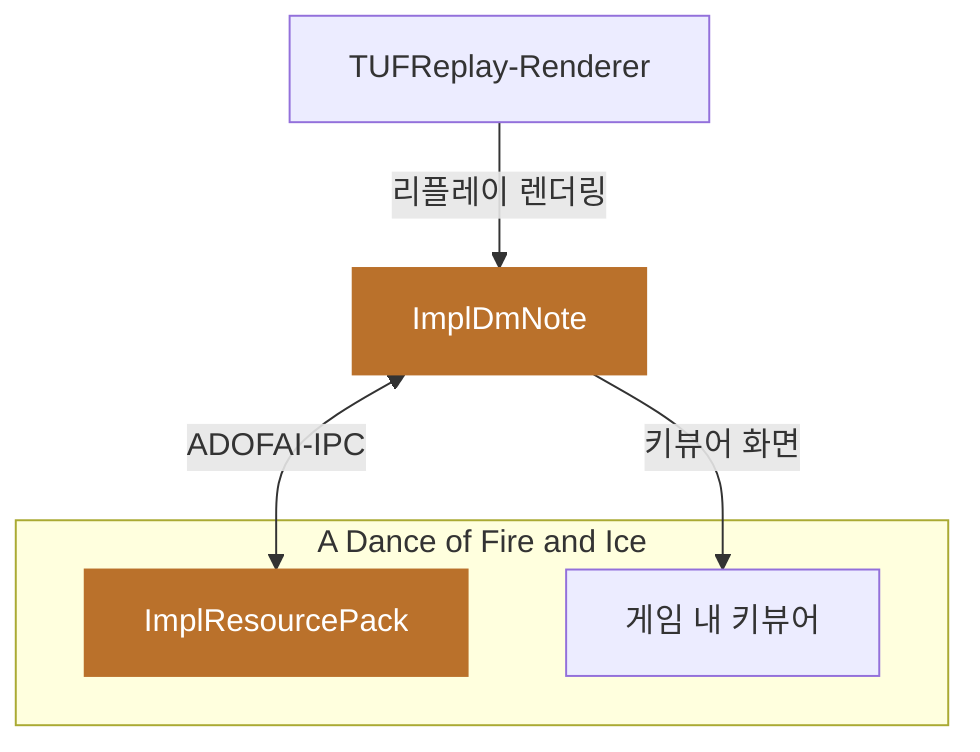

<p align="center">
얼불춤(A Dance of Fire and Ice) 오버레이·편의 기능 모드입니다.<br>
판정·정확도·BPM을 원하는 자리에 놓고, 키뷰어를 게임 화면 안에 띄웁니다.
</p>

## 쇼케이스

<table>
<tr>
<td width="50%" valign="top">
<video src="https://github.com/user-attachments/assets/bd995000-da71-4dc4-a5fd-3e5292c24df6" controls width="100%"></video>
<br><b>Tweaks</b> · 에디터 도구, 판정 문구 숨김, 행성 꾸미기
</td>
<td width="50%" valign="top">
<video src="https://github.com/user-attachments/assets/1a4a0234-938e-403c-8387-9fdea7e19432" controls width="100%"></video>
<br><b>Effects</b> · 프리셋 카드 한 번으로 이펙트 정리
</td>
</tr>
<tr>
<td width="50%" valign="top">
<video src="https://github.com/user-attachments/assets/a0d8aa55-0767-4038-b3a3-9e25380ce0b3" controls width="100%"></video>
<br><b>General</b> · 설정 단축키, 움직임 줄이기
</td>
<td width="50%" valign="top">
<video src="https://github.com/user-attachments/assets/4f5fe5dd-5a8a-4a57-a0fe-0f2ce8fcd394" controls width="100%"></video>
<br><b>Overlay</b> · 요소 추가와 배치, 하이라이트 색
</td>
</tr>
<tr>
<td colspan="2" valign="top">
<video src="https://github.com/user-attachments/assets/4136d2c5-f1bb-4bd7-82bd-5f389172175e" controls width="100%"></video>
<br><b>ImplDmNote</b> · 앱에서 고른 손·발 키뷰어가 게임 화면 안에 그대로 나타납니다
</td>
</tr>
</table>

## 기능

<table>
<tr>
<td width="33%" valign="top">

### 판정 오버레이
진행도·정확도·음악/맵 시간·타일 BPM·현재 BPM·KPS·FPS·판정·콤보·타이밍 스케일·곡 제목. 같은 요소를 여러 개 추가해 각각 배치합니다.

</td>
<td width="33%" valign="top">

### 끌어서 배치
드래그로 이동하고, 모서리와 변을 잡아 크기를 바꿉니다. 정렬선과 간격 맞춤, 실행 취소·다시 실행을 지원하고, 해상도가 바뀌어도 배치가 유지됩니다.

</td>
<td width="33%" valign="top">

### 게임 내 키뷰어
[ImplDmNote](#impldmnote)의 손·발 키뷰어를 게임 화면 안에 띄웁니다. 다른 요소처럼 Add Element에서 추가하고 위치와 크기를 정합니다.

</td>
</tr>
<tr>
<td valign="top">

### Effect Remover
22가지 이펙트를 하나씩 켜고 끌 필요 없이 프리셋 카드 한 번으로 바꿉니다. `Remove All` · `No Filters` · `Only Tiles`를 그대로 쓰거나 원하는 조합을 저장하세요. 원본 맵은 바뀌지 않습니다.

</td>
<td colspan="2" valign="top">

### Tweaks
- **행성 꾸미기**: 불·얼음·세 번째 공의 공·꼬리·고리 색과 불투명도를 바꿉니다.
- **에디터 도구**: 선택 구간의 각도·박자·타일 수·시간 표시, 정밀 회전, 타일을 뒤집거나 돌릴 때 이벤트 좌표 함께 맞추기.
- **판정 문구 숨김**: Perfect·Early·Miss·Overload 등 보고 싶지 않은 판정 문구를 골라 숨깁니다.
- **채터 블로커**: 스위치가 튀어 한 번 누른 키가 두 번 입력되는 것을 막습니다.

</td>
</tr>
</table>

그 밖에 녹화 모드(게임 HUD와 오버레이 한 번에 숨기기), macOS 트랙패드 제스처, ImplDmNote 키로 얼불춤 기본 키 리미터 설정, 하이라이트 색 변경, 움직임 줄이기, 한국어·영어 UI를 지원합니다.

## 시작하기

> [!NOTE]
> 아직 배포용 패키지가 없어 소스에서 빌드합니다. 게임 DLL을 참조하므로 게임이 설치된 PC에서 빌드하세요.

**필요한 것:** A Dance of Fire and Ice · [UnityModManager](https://github.com/newman55/unity-mod-manager) 0.27 이상 · Harmony

```bash
git clone https://github.com/KGH1113/ImplResourcePack.git
cd ImplResourcePack

cp .env.example .env        # ADOFAI_DIR 등 내 PC에 맞게 수정
./scripts/run.sh build      # Release 빌드 후 Mods/ImplResourcePack에 설치
```

게임에서 **왼쪽 <kbd>Alt</kbd> + <kbd>Tab</kbd>** (macOS는 <kbd>⌥</kbd> + <kbd>Tab</kbd>)을 누르면 설정 화면이 열립니다.

**게임 내 키뷰어 켜기**

1. [ImplDmNote](#impldmnote)를 실행하고 손·발 탭 중 하나를 고릅니다.
2. 앱 설정에서 **OBS 모드 활성화**를 켭니다. OBS 프로그램은 없어도 됩니다.
3. 게임 설정의 **Overlay → Add Element**에서 손 키뷰어나 발 키뷰어를 추가하고 저장합니다.

## 단축키

| 동작 | Windows | macOS |
| --- | --- | --- |
| 설정 화면 열기·닫기 | <kbd>왼쪽 Alt</kbd> + <kbd>Tab</kbd> | <kbd>왼쪽 ⌥</kbd> + <kbd>Tab</kbd> |
| 요소 선택 | <kbd>Tab</kbd> / <kbd>Shift</kbd> + <kbd>Tab</kbd> | 동일 |
| 1px / 10px 이동 | <kbd>←↑↓→</kbd> / <kbd>Shift</kbd> + <kbd>←↑↓→</kbd> | 동일 |
| 크기 조절 | <kbd>+</kbd> / <kbd>-</kbd> | 동일 |
| 저장 / 취소 | <kbd>Ctrl</kbd> + <kbd>Enter</kbd> / <kbd>Esc</kbd> | <kbd>⌘</kbd> + <kbd>Enter</kbd> / <kbd>Esc</kbd> |
| 요소 삭제 | <kbd>Ctrl</kbd> + <kbd>Delete</kbd> | <kbd>⌘</kbd> + <kbd>Delete</kbd> |
| 실행 취소 / 다시 실행 | <kbd>Ctrl</kbd> + <kbd>Z</kbd> / <kbd>Ctrl</kbd> + <kbd>Shift</kbd> + <kbd>Z</kbd> | <kbd>⌘</kbd> + <kbd>Z</kbd> / <kbd>⌘</kbd> + <kbd>Shift</kbd> + <kbd>Z</kbd> |
| 자동 맞춤 잠시 끄기 | <kbd>Alt</kbd> 누르는 동안 | <kbd>⌥</kbd> 누르는 동안 |
| 정밀 회전 (에디터) | <kbd>Ctrl</kbd> + <kbd>Alt</kbd> + <kbd>,</kbd> <kbd>.</kbd> | <kbd>⌘</kbd> + <kbd>⌥</kbd> + <kbd>,</kbd> <kbd>.</kbd> |

플레이 중에는 리듬 입력과 겹치지 않도록 이동·크기 조절 키에 <kbd>Ctrl</kbd>(macOS는 <kbd>⌘</kbd>)을 함께 누릅니다.

## 구조

모드와 앱은 [ADOFAI-IPC](https://github.com/KGH1113/adofai-ipc)로 명령과 상태를 주고받습니다.



## 플랫폼

| 플랫폼 | 게임 내 키뷰어 |
| --- | --- |
| macOS 11 이상 | 지원 |
| Windows 10 이상 | 지원 · Microsoft Edge WebView2 런타임 필요 (Windows 11 기본 포함) |
| Linux | 미지원 |

## ImplDmNote

[`apps/impl-dm-note`](apps/impl-dm-note)는 DM Note v1.6.1을 기반으로 한 키뷰어 데스크톱 앱입니다. 모드와 따로 실행되며 키 프로필을 모드와 동기화합니다.

- 손·발 키뷰어, 키 입력 횟수, 프리셋, 키음, 커스텀 CSS
- 키마다 고스트 키: 같은 자리에 두 번째 키를 연결하고 따로 꾸밉니다. 키 리미터에는 들어가지 않습니다.
- 게임 화면 안 키뷰어와 방송용 OBS 브라우저 소스
- TUFReplay-Renderer와 연동한 리플레이 영상 렌더링

```bash
npm install
npm run desktop:dev
```

## 라이선스

| 범위 | 라이선스 |
| --- | --- |
| 저장소 루트 (아래 예외 제외) | source-available proprietary. 개인·비상업적 공식 빌드 사용과 공식 저장소 기여 준비만 허용. [`LICENSE.md`](LICENSE.md) |
| `apps/impl-dm-note/**` | GPL-3.0-only. [`LICENSE`](apps/impl-dm-note/LICENSE) · [`UPSTREAM.md`](apps/impl-dm-note/UPSTREAM.md) |
| 서드파티 코드·폰트·자산 | 각 고유 조건. [`THIRD_PARTY_NOTICES.md`](THIRD_PARTY_NOTICES.md) |

기여는 [`CONTRIBUTING.md`](CONTRIBUTING.md)와 [`CONTRIBUTOR_AGREEMENT.md`](CONTRIBUTOR_AGREEMENT.md)를 먼저 읽어 주세요.
