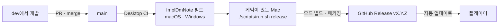

# 릴리스



모드는 게임 DLL을 참조하므로 CI에서 빌드하지 않습니다. CI는 ImplDmNote만
빌드하고, 모드 빌드와 패키징·게시는 게임이 설치된 Mac에서 합니다.

## 순서

1. **dev에서 버전 올리기.** 모드와 ImplDmNote는 같은 버전을 씁니다.

   ```bash
   ./scripts/run.sh version 0.3.0   # Info.json, package.json, tauri.conf.json, Cargo.toml/lock, package-lock.json
   ./scripts/run.sh version         # 모두 같은지 확인
   ```

   릴리스 노트를 직접 쓰려면 `docs/releases/0.3.0.md`를 추가합니다. 없으면
   GitHub이 PR 목록으로 만듭니다.

2. **PR로 main에 merge.** Desktop CI가 버전 일치를 확인하고 ImplDmNote를
   빌드합니다. main에 push된 실행은 `impl-dm-note-macos-app`,
   `impl-dm-note-windows-portable` 아티팩트를 남깁니다. 앱 코드가 바뀌지 않은
   merge는 CI를 돌리지 않고, 릴리스는 같은 앱 소스로 만든 이전 빌드를 씁니다.

3. **Windows 게임 내 키뷰어 확인.** 릴리스에는 스모크 테스트를 통과한
   `ImplGameWebView.dll`이 들어갑니다.

   ```bash
   ./scripts/run.sh windows-webview-check
   ```

4. **게시.**

   ```bash
   git switch main && git pull --ff-only
   ./scripts/run.sh release
   ```

   - main이 origin/main과 같고 작업 트리가 깨끗한지, `vX.Y.Z` 태그와 릴리스가
     아직 없는지 확인합니다.
   - HEAD와 앱 소스가 같은 성공한 Desktop CI 실행에서 앱을 받습니다. 실행
     중이면 끝날 때까지 기다립니다.
   - C# 테스트를 돌리고, 모드를 Release로 빌드해 `ImplResourcePack-macos.zip`,
     `ImplResourcePack-windows.zip`, `ImplResourcePack.update.json`을 만듭니다.
   - 초안 릴리스로 올리고 크기를 확인한 뒤, 게시할지 묻습니다(`--yes`로
     생략). 게시 후 `releases/latest/download/ImplResourcePack.update.json`이 새
     버전을 가리키는지 확인합니다.

   대답하지 않고 초안으로 남겼다면 GitHub에서 확인한 뒤
   `gh release edit vX.Y.Z --draft=false --latest`로 게시합니다.

## 문제가 생기면

| 메시지 | 할 일 |
|---|---|
| No successful Desktop CI run on main built the ImplDmNote sources at HEAD | 아티팩트가 만료됐거나 CI가 실패했습니다. `gh workflow run desktop-ci.yml --ref main` 후 다시 실행합니다. |
| vX.Y.Z already exists | 이미 낸 버전입니다. dev에서 버전을 올려 다시 merge합니다. |
| The Windows in-game viewer library has not passed its smoke probe | `./scripts/run.sh windows-webview-check`를 먼저 실행합니다. |
| Comment out these .env settings for a release | 릴리스는 두 OS와 ImplDmNote를 항상 포함합니다. 해당 줄을 주석 처리합니다. |

게시한 릴리스를 되돌리려면 그 릴리스를 지우지 말고 더 높은 버전을 냅니다.
업데이터는 낮은 버전으로 내려가지 않습니다. 새 버전이 시작조차 안 되는
경우에는 각 설치가 이전 버전으로 돌아가고 그 버전을 건너뜁니다.

프리릴리스(`0.3.0-beta.1`)는 `--prerelease`로 게시되며 자동 업데이트로는
배포되지 않습니다.
