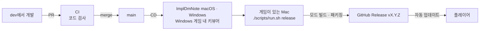

# 릴리스



- **CI**(`.github/workflows/ci.yml`): main으로 가는 모든 PR을 검사하고 아무것도
  남기지 않습니다. 버전 일치, 셸·PowerShell 스크립트, ImplDmNote의 프론트엔드·Rust
  검사와 의존성 감사, 키뷰어 스크린샷, Windows 게임 내 키뷰어의 MSVC 빌드와
  스모크 테스트를 돌립니다.
- **CD**(`.github/workflows/cd.yml`): main에 merge될 때마다 릴리스에 들어갈 것을
  빌드해 아티팩트로 올립니다. `impl-dm-note-macos-app`,
  `impl-dm-note-windows-portable`, 스모크 테스트를 통과한
  `impl-game-webview-windows`(`ImplGameWebView.dll`)입니다.
- 모드는 게임 DLL을 참조하므로 GitHub에서 빌드하지 않습니다. 모드 검사는
  `./scripts/run.sh mod-check`(pre-push 훅)이고, 모드 빌드와 패키징·게시는 게임이
  설치된 Mac에서 합니다.

## 순서

1. **dev에서 버전 올리기.** 모드와 ImplDmNote는 같은 버전을 씁니다.

   ```bash
   ./scripts/run.sh version 0.3.0   # Info.json, package.json, tauri.conf.json, Cargo.toml/lock, package-lock.json
   ./scripts/run.sh version         # 모두 같은지 확인
   ```

   릴리스 노트를 직접 쓰려면 `docs/releases/0.3.0.md`를 추가합니다. 없으면
   GitHub이 PR 목록으로 만듭니다.

2. **dev에서 main으로 PR.** CI가 통과하면 merge합니다.

3. **CD를 기다립니다.** merge가 CD를 시작합니다(약 15분).

4. **게시.**

   ```bash
   git switch main && git pull --ff-only
   ./scripts/run.sh release
   ```

   - main이 origin/main과 같고 작업 트리가 깨끗한지, `vX.Y.Z` 태그와 릴리스가
     아직 없는지 확인합니다.
   - HEAD와 같은 소스로 빌드한 성공한 CD 실행에서 앱 두 개와 키뷰어 DLL을
     받습니다. 실행 중이면 끝날 때까지 기다립니다.
   - C# 테스트를 돌리고, 모드를 Release로 빌드해 `ImplResourcePack-macos.zip`,
     `ImplResourcePack-windows.zip`, `ImplResourcePack.update.json`을 만듭니다.
   - 초안 릴리스로 올리고 크기를 확인한 뒤, 게시할지 묻습니다(`--yes`로
     생략). 게시 후 `releases/latest/download/ImplResourcePack.update.json`이 새
     버전을 가리키는지 확인합니다.

   대답하지 않고 초안으로 남겼다면 GitHub에서 확인한 뒤
   `gh release edit vX.Y.Z --draft=false --latest`로 게시합니다.

개발 중에 Windows용 빌드가 필요하면(`windows-install`) dev를 push하고
`gh workflow run cd.yml --ref dev`로 CD를 직접 돌립니다.

## 문제가 생기면

| 메시지 | 할 일 |
|---|---|
| No CD run on main has downloadable builds of the sources at HEAD | 아티팩트가 만료됐거나(90일) CD가 실패했습니다. `gh workflow run cd.yml --ref main` 후 다시 실행합니다. |
| CD run N failed | `gh run view N --log-failed`로 원인을 보고 dev에서 고쳐 다시 merge합니다. |
| vX.Y.Z already exists | 이미 낸 버전입니다. dev에서 버전을 올려 다시 merge합니다. |
| Comment out these .env settings for a release | 릴리스는 두 OS와 ImplDmNote를 항상 포함합니다. 해당 줄을 주석 처리합니다. |

게시한 릴리스를 되돌리려면 그 릴리스를 지우지 말고 더 높은 버전을 냅니다.
업데이터는 낮은 버전으로 내려가지 않습니다. 새 버전이 시작조차 안 되는
경우에는 각 설치가 이전 버전으로 돌아가고 그 버전을 건너뜁니다.

프리릴리스(`0.3.0-beta.1`)는 `--prerelease`로 게시되며 자동 업데이트로는
배포되지 않습니다.
