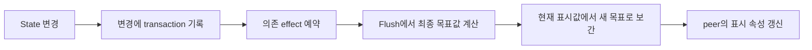

# ElementUI 재조사: 이 화면을 SwiftUI로 작성한다면

2026-11-17 · 현재 구현을 다시 읽고 화면별로 역설계한 2차 조사. 구현 코드 변경 없음.

**결론부터 말하면, 현재 ElementUI에는 선언형 UI를 짧게 만드는 기본 표현 계층이 크게 빠져 있다.** `.Opacity`, presentation transform, 상태 기반 animation, transition, shape 조합, 입력·focus·lifecycle 표현이 부족해서 화면 코드가 그 일을 직접 수행한다. `HStack`과 `Bind`가 있다는 것만으로 SwiftUI와 비슷한 작성 경험이 만들어지지는 않는다.

앞선 조사는 공개 API 목록과 개별 예외를 찾는 데 비중이 컸고, 일상적인 화면 코드가 얼마나 많은 표현 책임을 떠안는지 충분히 드러내지 못했다. 특히 범용 animation을 후순위로 둔 판단을 수정한다. **Opacity·Offset·ScaleEffect·Animation(value:)·WithAnimation은 검색창의 plain field와 함께 먼저 갖춰야 할 기반 기능이다.**

이번에는 `현재 코드가 하는 일 → 자연스러운 SwiftUI 표현 → 없어져야 할 수동 작업 → 필요한 ElementUI 계약` 순서로 조사했다. 개별 화면을 SwiftUI로 다시 구성한 코드는 다음 세 문서에 있다.

| 사례집 | 다루는 실제 코드 | 읽을 때 볼 점 |
| --- | --- | --- |
| [불투명도·변형·모션](elementui-swiftui-cases/motion.md) | 설정창 등장, toast, 아이콘 press/hover, 표시용 switch, disabled 버튼, 편집기 fade, 값 범위 band | 기본 modifier가 없어서 생기는 시간·좌표·알파·종료 처리 |
| [컨트롤·설정 화면](elementui-swiftui-cases/controls-and-screens.md) | SwitchCards, ColorSwatch, 프로필 생성·이름 변경, preset 탭, 설정창 여백, inspector 행, toolbar | State/Binding·style·동적 layout·작은 View 조합으로 옮겼을 때의 구조 |
| [입력·오버레이 편집기](elementui-swiftui-cases/overlay-and-input.md) | 검색창, HEX/% 입력, Grow 선택, 값 목록·chip, popup, 색상 도구 | 일반 입력과 장식 때문에 native API로 내려가는 지점과 custom drawing의 경계 |

SwiftUI 코드는 설계 비교를 위한 스케치다. 별도 macOS/iOS 프로젝트로 컴파일하거나 시각 검증하지 않았다. 생략한 도메인 모델·명령·custom drawing은 각 사례에서 구분하며, 짧은 코드가 현재의 모든 행동을 공짜로 재현한다고 가정하지 않는다. SwiftUI의 모든 플랫폼 기능을 Unity에 그대로 이식하자는 제안도 아니다.

modifier 조합 결함과 전체 API 표면의 근거는 [1차 API 조사](elementui-swiftui-api-audit.md), 버튼의 기본·hover 도형 소유권과 OnHover는 [Text 패널 조사](elementui-inspector-api-cases.md)에도 연결되어 있다. 우선순위와 화면별 비교는 이 2차 조사를 기준으로 한다.

## 가장 명확한 변화: 상태의 모습만 선언할 수 있어야 한다

현재 [SwitchIndicator.Paint](/Users/kgh/dev/src/impl-resourcepack/Element/Presentation/Ui/Declarative/Controls/SwitchIndicator.cs:71)는 다음을 직접 한다.

- available 상태를 읽어 alpha를 결정한다.
- track과 thumb의 Color.a를 각각 수정한다.
- true/false/mixed에 따라 thumb의 x를 계산한다.
- 별도 UiSwitchMotion 컴포넌트에 목표 x를 넘긴다.
- 그 컴포넌트가 Update에서 보간하고 정지 조건을 판단한다.

SwiftUI로 표현하면 원리는 이 정도다. `thumbTravel`은 false=0, true=12, mixed=6인 도메인 계산이며, 색 이름은 현재 테마에 해당한다.

```swift
ZStack(alignment: .leading) {
    Capsule().fill(trackColor)

    Circle()
        .fill(thumbColor)
        .frame(width: 10, height: 10)
        .offset(x: 4 + thumbTravel)
}
.frame(width: 30, height: 18)
.opacity(isAvailable ? 1 : 0.4)
.allowsHitTesting(false)
.animation(reduceMotion ? nil : .easeOut(duration: 0.16), value: isOn)
```

이 스케치는 subtree 전체에 animation을 적용하므로 track·thumb 색도 함께 보간될 수 있다. 현재 구현은 색을 즉시 바꾸고 thumb 위치만 움직인다. 현재 행동을 그대로 보존하려면 animation 범위를 thumb offset에만 한정해야 한다. SwiftUI의 `animation(_:body:)`처럼 특정 효과만 범위에 넣는 방법도 비교 대상이며, ElementUI에도 속성별 범위나 animation 제외 규칙이 필요하다. [Apple animation(_:body:)](https://developer.apple.com/documentation/swiftui/view/animation%28_%3Abody%3A%29)

상태별 색과 위치 계산은 남는다. 반면 GameObject 생성, track/thumb의 알파 동기화, 보간용 MonoBehaviour, Update 켜기·끄기, 완료 임계값은 이 컴포넌트가 직접 소유할 필요가 없다. 이것은 복잡한 게임 canvas가 아니라 재사용 가능한 보통 UI다.

ElementUI에서도 다음과 같은 구조가 목표가 되어야 한다. **아래 C#의 Shape·Opacity·Offset·Animation 등은 제안 API이며 현재 존재하지 않는다.**

```csharp
ZStack(Alignment.Leading,
    Capsule().Fill(() => TrackColor()),
    Circle().Fill(() => ThumbColor())
        .Frame(width: 10, height: 10)
        .Offset(x: () => 4 + ThumbTravel()))
.Frame(width: 30, height: 18)
.Opacity(() => VM.Available.Value ? 1 : .4f)
.AllowsHitTesting(false)
.Animation(Motion.EaseOut(.16f), value: () => VM.On.Value);
```

정확한 이름과 overload는 나중에 정할 수 있다. 중요한 것은 **상태에 따른 최종 모습은 View가 선언하고, 그 모습 사이의 이동은 공통 runtime이 수행하는 계약**이다. SwiftUI도 opacity와 scale 같은 animatable 효과를 상태 변화에 연결하고, 사용자 정의 값에는 Animatable을 사용한다. [Apple Animations](https://developer.apple.com/documentation/SwiftUI/Animations)

## 실제 코드에서 거꾸로 도출한 기본 기능

아래 표의 “없음”은 확인한 현재 public DSL 기준이다. Unity 자체로 구현할 수 없다는 뜻이 아니다. 실제로 그 우회 구현이 존재해서 코드가 길어지고 있다.

| SwiftUI라면 쓰는 표현 | 현재 Element에서 대신 하는 일 | ElementUI 상태와 개선 판단 |
| --- | --- | --- |
| `.opacity(state ? 1 : .4)` | track/thumb별 alpha 곱셈, CanvasGroup 생성과 alpha 설정 | **없음. P0**: 고정·반응형 subtree opacity |
| `.offset(...)` | anchoredPosition에 delta를 더하고, 다음 프레임에 다시 뺌 | **없음. P0**: layout 위치와 별도인 presentation offset |
| `.scaleEffect(...)` | glyph localScale 직접 변경, disable 때 복구 | **없음. P0**: transform anchor와 별도 hit target |
| `.rotationEffect(...)` | gradient handle 방향용 quaternion 계산 | **없음**: transform 계열의 일관성. 실제 반복 수요는 opacity/offset/scale보다 작음 |
| `.animation(curve, value: state)` | 각 컴포넌트가 current/target/time/Update를 관리 | **없음. P0**: 상태 변화와 animatable 속성을 연결 |
| `withAnimation { ... }` | 상태 변경과 개별 tween 호출을 수동으로 맞춤 | **없음. P0**: 하나의 변경에 animation transaction 부여 |
| `.transaction { ... }` 또는 animation=nil | 첫 표시·drag·reduce-motion 예외를 각 클래스에 구현 | **없음. P0 계약**: scoped override와 즉시 반영 |
| `.transition(...)` | alpha를 0으로 만든 뒤 별도 callback으로 숨김/제거 | **없음. P0/P1**: 등장·퇴장과 실제 수명 변경을 조정 |
| `.allowsHitTesting(false)` | Graphic.raycastTarget, CanvasGroup.blocksRaycasts 설정 | **없음. P0/P1**: 시각 효과와 입력 차단을 분리 |
| `.contentShape(...)` | 별도 Raycast용 graphic·pointer component | **없음. P1**: 시각 크기와 interaction shape 분리 |
| `Circle/Capsule.fill`, `.stroke`, `.clipShape` | 단순 swatch/switch에도 native Graphic, Mask, RectTransform 생성 | **없음. P0/P1**: shape를 합성할 기본 어휘 |
| `.background { ... }`, `.overlay { ... }` | 장식용 ZStack과 프레임·inset의 수동 일치 | 색 Background만 있음. **View 장식 조합은 없음** |
| `.padding(.horizontal, compact ? 20 : 32)` | 조건부 Spacer 두 개로 gutter를 바꿈 | 고정 Padding만 있음. **반응형 layout 속성 부족** |
| `.frame(width: state)` | 재구성·분기·native bounds 변경으로 표현 | 고정 Frame은 있음. **반응형 치수 계약 부족** |
| `.layoutPriority`, `.fixedSize`, baseline | 폭을 계산하거나 label·row 상수로 보정 | **없음**: 압축 순서·intrinsic 크기·정렬의 표현 부족 |
| `Image(...).resizable().scaledToFit()` | TextureImage가 RawImage 생성·texture 감시·종횡비 계산 | Icon Image만 있음. **일반 image 표현 부족** |
| `.buttonStyle(...)`, `.toggleStyle(...)` | 별도 theme enum과 native pressed/hover 구현 | ControlStyle은 있으나 Button 경로·상태 configuration이 불완전 |
| `.tint`, `.controlSize`, `.labelsHidden` | 테마·라벨·색·프레임을 helper마다 재작성 | 동일한 범위의 public modifier 없음 |
| `.textFieldStyle(.plain)` | 입력 배경과 viewport를 TMP로 직접 수정 | **없음. P0**: 장식 없는 editable primitive |
| `.focused`, `.onSubmit`, `.onChange` | TMP 참조·UnityEvent·focus 요구 번호 | **없음. P0/P1**: 입력과 상태 변화의 공개 계약 |
| `.onHover` | pointer handler 추가, Hint 내부 기능을 사용자가 재사용 못 함 | backend enter/exit는 있음. **공개 modifier 없음** |
| `.onAppear/.onDisappear`, `.task(id:)` | 화면 수명용 0-size NativeView, timeout과 cleanup 직접 연결 | 일반 합성용 lifecycle/task API 없음 |
| `@Environment(\.isEnabled/reduceMotion)` | EnabledWatch와 각 모션 클래스의 preference 인자 | 환경 전달 일부만 있음. **일반 View의 읽기·확장 부족** |
| `@State + var body`만 있는 작은 View | View<TVM>에 모델을 준비하거나 method/native subclass 사용 | local State는 있음. **모델 없는 합성 기본형 부족** |
| selection Binding + `.onChange` | 탭마다 Command를 만들고 부수 동작을 결합 | binding 일부는 있음. Tabs selection·generic change hook 부족 |
| ScrollViewReader/scroll position + lazy list | ScrollRect 직접 설정, 전체 row mount | 기본 ScrollView/ForEach는 있음. 제어·lazy container 부족 |
| `.zIndex` 또는 presentation 계층 | SetAsLastSibling 호출로 popup/ghost/tip 순서를 정함 | source order·Popover는 있음. 일반 동적 depth 표현은 없음 |
| `.shadow`, shape border, text tracking | native theme/graphic/TMP에서 개별 처리 | public 표면 부족. 위 P0 기능보다 직접 사례·우선순위는 낮음 |

공개 표면 근거: [UI.cs](/Users/kgh/dev/src/ElementUI/src/ElementUI.Core/UI.cs), [ViewModifiers.cs](/Users/kgh/dev/src/ElementUI/src/ElementUI.Core/ViewModifiers.cs), [Peers.cs:75](/Users/kgh/dev/src/ElementUI/src/ElementUI.Core/Backend/Peers.cs:75). 대응하는 실제 소비 코드와 줄 번호는 각 사례집에 있다.

이 표는 새 메서드를 28개 만들자는 작업 목록이 아니다. 예를 들어 shape+opacity+transform+animation이 있으면 표시용 switch와 swatch 같은 여러 전용 native 클래스를 작은 View 조합으로 작성할 수 있다. 기능 하나의 가치는 그것이 없어서 반복하는 여러 책임을 얼마나 공통화하는지로 판단해야 한다.

## Opacity를 먼저 넣어야 하는 이유

`.Foreground(color with alpha)`는 Text/Icon의 색만 바꾸고, `.Background(color with alpha)`는 배경만 바꾼다. `.Hidden`은 보이거나 안 보이는 선택이다. 어느 것도 “이 컴포넌트 전체를 40%로 보이게 한다”는 표현의 대체가 아니다.

구체적인 반복은 다음과 같다.

- [SwitchIndicator.cs:71](/Users/kgh/dev/src/impl-resourcepack/Element/Presentation/Ui/Declarative/Controls/SwitchIndicator.cs:71): track와 thumb에 각각 alpha를 곱한다.
- [UiButton.cs:62](/Users/kgh/dev/src/impl-resourcepack/Element/Presentation/Ui/Widgets/UiButton.cs:62): disabled 상태의 CanvasGroup alpha를 별도 subclass가 변경한다.
- [SettingsWindowMotion.cs:26](/Users/kgh/dev/src/impl-resourcepack/Element/Presentation/Settings/SettingsWindowMotion.cs:26): 창 전체 alpha와 fade clock을 관리한다.
- [OverlayEditorFrame.cs:65](/Users/kgh/dev/src/impl-resourcepack/Element/Presentation/Layout/ContentEditors/Shell/OverlayEditorFrame.cs:65): 다른 host에서 같은 CanvasGroup fade 기반을 다시 만든다.
- [UiToastMotion.cs:48](/Users/kgh/dev/src/impl-resourcepack/Element/Presentation/Ui/Widgets/UiToastMotion.cs:48): toast 진입·퇴장 alpha를 시간 함수로 계산한다.

최소 계약에는 고정값/추적식, 0–1 범위, 조상 opacity와의 결합, native 자식을 포함한 일관된 적용이 필요하다. opacity가 0이어도 layout·identity·수명을 어떻게 유지할지, 입력은 어떤 API로 제어할지 명확해야 한다. `Disabled`, hit testing, Hidden, unmount를 한 스위치로 섞으면 나중에 exit transition을 만들기 어렵다.

SwiftUI는 중복 적용된 opacity 효과가 곱해진다고 설명한다. 다만 겹치는 자식을 먼저 하나의 offscreen image로 합성할지의 문제는 별도의 compositing 개념이다. CanvasGroup 하나를 붙이면 모든 SwiftUI 합성 동작을 그대로 재현한다고 가정하지 말고, 필요한 opacity/compositing 규칙을 정해야 한다. [Apple opacity](https://developer.apple.com/documentation/swiftui/view/opacity(_:))

## Offset이 없어서 레이아웃과 애니메이션이 서로의 값을 복구한다

설정창의 [RemoveOffset](/Users/kgh/dev/src/impl-resourcepack/Element/Presentation/Settings/SettingsWindowMotion.cs:62)은 현재 anchoredPosition이 자신이 마지막에 적용한 값인지 비교한다. FitWindow가 해상도 변경 때문에 위치를 바꿨다면 이전 animation offset을 빼지 않는다.

이것은 작성자가 부주의해서 생긴 코드가 아니라, **레이아웃 좌표와 표시 좌표를 같은 RectTransform 값에 쓰기 때문에 필요한 보정**이다. layout 결과에 독립적인 presentation transform을 합성할 수 있다면 화면별로 이런 복구 규칙을 작성하지 않아도 된다.

SwiftUI의 offset/scale에 해당하는 기능을 구현할 때에도 다음 구분이 필요하다.

| 속성 종류 | 담당 책임 | 애니메이션 중 기대 |
| --- | --- | --- |
| Frame/Padding/layout | 부모·형제의 공간 배분 | 실제 치수가 바뀌면 필요한 layout 갱신 |
| Offset/Scale/Rotation | 배치된 결과의 표시 변형 | 의도하지 않은 형제 재배치 없이 표시 변화 |
| Hit shape | 클릭·hover·drag 대상 범위 | glyph만 눌려 작아져도 버튼 target은 유지 가능 |
| Clip/mask | 표시되는 영역 제한 | transform과 조합 순서가 명확해야 함 |

이런 의미가 일관되어야 modifier를 붙이는 순서가 읽을 수 있는 UI 코드가 된다. 앞선 조사에서 찾은 ForEach/If flattening, Spacer/Divider의 직접 부모 의존 문제도 이 기본 조합 계약의 일부다.

## Animation(value:)와 WithAnimation은 서로 다른 두 표현이다

**Animation(value:)는 View가 소유하는 정책이다.** 특정 값이 바뀌면 해당 범위의 animatable 표현을 어떤 곡선으로 갱신할지 정한다. `value`가 bool이더라도 bool 자체를 중간값으로 바꾸는 것이 아니다. 그 bool에서 계산된 opacity·offset·color 같은 표시값을 보간한다. 같은 갱신 범위에서 다른 속성이 함께 바뀔 때 어디까지 animation이 적용될지도 정의해야 한다. [Apple animation(_:value:)](https://developer.apple.com/documentation/swiftui/view/animation(_:value:))

**WithAnimation은 상태를 바꾸는 동작이 소유하는 정책이다.** 예를 들어 목록 선택·패널 열림·강조 색을 한 action에서 바꾸면 같은 transaction으로 나타나게 한다. SwiftUI의 withAnimation도 현재 Transaction의 animation을 설정한다. [Apple withAnimation](https://developer.apple.com/documentation/swiftui/withanimation(_:_:))

제안 형태는 다음과 같다. **현재 구현된 C# API가 아니다.**

```csharp
// View 쪽: 어떤 상태 변화에 반응할지 선언.
panel
    .Opacity(() => VM.Open.Value ? 1 : 0)
    .Offset(y: () => VM.Open.Value ? 0 : -8)
    .Animation(Motion.EaseOut(.18f), value: () => VM.Open.Value);

// 동작 쪽: 이 변경에서 파생된 여러 표시값을 함께 전환.
WithAnimation(Motion.EaseOut(.18f), () =>
{
    VM.Selected.Value = next;
    VM.Open.Value = true;
});
```

두 표현을 함께 지원하면 화면마다 Motion class를 만드는 대신 재사용 가능한 View·style에 정책을 넣거나 특정 action에서만 animation을 선택할 수 있다.

### 기존 runtime에서 반드시 해결해야 할 부분

ElementUI에는 이미 work가 있을 때만 동작하는 driver와 내부 animation 목록이 있다. 하지만 [StartAnimation](/Users/kgh/dev/src/ElementUI/src/ElementUI.Core/Reactive/Runtime.cs:84)과 IAnimation은 internal이며 일부 내장 peer가 사용한다. 현재 앱의 UiSwitchMotion·UiIconInteraction·SettingsWindowMotion·UiToastMotion·OverlayValueColorBandMotion은 별도로 Update와 종료 처리를 작성한다.

따라서 새 timer를 각 modifier에 붙이는 방식보다 기존 runtime에 공개 animatable property와 transaction 경로를 추가하는 편이 맞다. 특히 [Schedule](/Users/kgh/dev/src/ElementUI/src/ElementUI.Core/Reactive/Runtime.cs:64)은 effect를 queue에 넣고, [RunEffects](/Users/kgh/dev/src/ElementUI/src/ElementUI.Core/Reactive/Runtime.cs:152)는 나중에 실행한다. WithAnimation 블록 동안 전역 CurrentAnimation만 잠깐 설정하면 실제 apply 시점에는 이미 해제되어 있을 수 있다.



필요한 계약은 다음과 같다.

1. **모델값과 표시값 분리.** 모델은 바로 최종값을 갖고 표시값만 보간한다. slider 값·설정 저장·undo가 animation 프레임마다 재실행되어서는 안 된다.
2. **transaction 보존.** effect를 queue에 넣고 합치는 동안 animation 정책을 보존한다. 중첩 transaction, 같은 frame의 복수 변경, local override의 우선순위를 정의한다.
3. **재목표화와 중단.** 새 목표가 오면 이전 목표가 아니라 현재 보이는 값에서 이어간다. spring을 제공하면 속도 연속성도 다뤄야 한다.
4. **첫 표시와 직접 조작.** 초기 mount, drag, undo, resize에 animation을 쓸지 선택할 수 있어야 한다. 모든 갱신을 무조건 애니메이션하면 안 된다.
5. **lifecycle.** hidden·inactive·unmount·dispose·reopen에서 animation과 callback이 어떻게 끝나는지 명시한다.
6. **reduce motion.** 화면마다 bool을 전달하고 곡선을 건너뛰는 코드 대신 환경 또는 공통 policy로 지정할 수 있어야 한다.
7. **custom animatable 값.** 값 범위 band처럼 domain drawing은 유지하되 scalar/pair의 보간과 driver는 공유할 수 있어야 한다.

이 계약을 위해 SwiftUI처럼 View Body 전체를 다시 실행하는 엔진으로 갈아엎을 필요는 없다. 현재 retained tree와 세밀한 의존성 추적을 유지하면서 속성·구조 변경에 transaction을 실어 나르는 방식으로 설계할 수 있다.

## Transition은 Opacity의 별칭이 아니다

toast를 지울 때 alpha를 0으로 바꾸는 것과, 조건을 false로 바꿔 View를 없애는 것은 다르다. 화면에서 바로 제거하면 exit animation을 보여 줄 대상이 사라진다.

현재 If는 이전 branch를 곧바로 숨기고 비활성화한다. [Structure.cs:124](/Users/kgh/dev/src/ElementUI/src/ElementUI.Core/Views/Structure.cs:124). Popover는 Close에서 바로 unmount한다. [Overlays.cs:99](/Users/kgh/dev/src/ElementUI/src/ElementUI.Core/Views/Overlays.cs:99). `.Transition`을 추가하려면 퇴장 중인 표시 인스턴스를 완료까지 유지하고, 입력은 적절히 차단한 뒤 기존 keep-alive/disposal 규칙으로 넘겨야 한다.

새 toast가 들어오면 이전 timeout을 취소하는 문제, 퇴장 중 다시 열었을 때 이어갈지 새로 만들지의 문제도 여기에 속한다. 이를 화면마다 callback과 GameObject.SetActive로 해결하도록 두면 API 이름만 SwiftUI와 비슷해질 뿐 작성 경험은 그대로다.

## 작은 도형과 이미지도 native bridge가 기본 경로여서는 안 된다

현재 [SwatchDot](/Users/kgh/dev/src/impl-resourcepack/Element/Presentation/Ui/Declarative/Controls/SwatchDot.cs:36)은 링·색·gradient child를 만들고 Mask를 붙이며 각 graphic의 raycast를 끈다. 단색 swatch의 의도는 SwiftUI의 `Circle().fill(...).overlay(Circle().stroke(...))`로 표현할 수 있다.

gradient를 그리는 앱 고유 코드가 필요하더라도 그 밖의 clipping·ring·크기·입력 제외까지 해당 클래스가 다시 구현할 이유는 없다. 예를 들어 다음에서 `SwatchPaint`만 앱의 gradient renderer로 남을 수 있다. 아래는 배치 의도 예시이며 실제 링의 광학적 치수는 검증해야 한다.

```swift
SwatchPaint(color: color, gradient: gradient) // 앱의 paint 표현
    .clipShape(Circle())
    .overlay { Circle().stroke(.white.opacity(0.5), lineWidth: 2) }
    .frame(width: 18, height: 18)
    .allowsHitTesting(false)
```

마찬가지로 [TextureImage](/Users/kgh/dev/src/impl-resourcepack/Element/Presentation/Ui/Declarative/Controls/TextureImage.cs:26)의 native texture를 받는 지점은 backend bridge일 수 있다. 하지만 `Fit()`의 비율 유지 계산, resize 처리, 가운데 배치, raycast 끄기는 일반 Image+resizable+scaledToFit 계약으로 올릴 수 있는 일이다. “RenderTexture이므로 NativeView가 정당하다”는 설명만으로 그 주변의 반복 구현까지 유지할 이유는 없다.

## 검색창·입력·설정 화면에서 달라진 판단

이 관점은 첫 검색창에도 그대로 적용된다. plain input만 추가하면 한 단계 나아가지만 충분하지 않다.

- focus와 submit/cancel/change를 선언할 수 있어야 `Dress()`의 UnityEvent 연결도 사라진다.
- clear 버튼의 등장과 소멸을 transition으로 표현할 수 있어야 별도 animation class가 필요하지 않다.
- 부모 font와 control size를 자식들이 일관되게 따라야 각 leaf에 스타일을 반복하지 않는다.
- compact에 따른 padding을 식으로 전달할 수 있어야 조건부 Spacer로 좌우 여백을 만드는 코드가 필요하지 않다.
- selection binding과 onChange가 있어야 탭을 바꿀 때 shortcut 편집을 취소하려고 탭별 Command 배열을 만들지 않아도 된다.
- 일반 View에서 environment를 읽을 수 있어야 enabled 상태를 읽기 위한 0-size NativeView가 필요하지 않다.

단, 기존 기능을 잘못 없는 것으로 세지 않도록 재확인한 내용도 있다. **Bind는 field만 받는 것이 아니다.** public setter가 있는 auto-property, 허용된 `[Pure]` property/getter 경로, State.Value도 지원한다. 임의 getter/setter delegate binding과 projection의 부재는 별개다. 근거: [MemberPath.cs:137](/Users/kgh/dev/src/ElementUI/src/ElementUI.Core/Reactive/MemberPath.cs:137), [Lowering.cs:209](/Users/kgh/dev/src/ElementUI/src/ElementUI.Core/Reactive/Lowering.cs:209). 앞선 조사 문서의 field-only 표현은 수정했다.

Computed, keyed ForEach, null child 조합, fixed Padding/Frame, ControlStyle 등은 이미 있다. 그러나 이런 기능의 존재를 이유로 부족한 기본 표현을 후순위로 둘 수는 없다. **현재 기능으로 가능한 작은 정리와, framework가 기본 책임을 가져와야 가능한 큰 단순화는 모두 추진 대상이다.**

## 구현 순서를 다시 정한다면

| 순서 | 묶어서 완성할 기능 | 실제 화면으로 확인할 완료 기준 |
| --- | --- | --- |
| 1 | 구조를 보존하는 modifier, Opacity·Offset·ScaleEffect, hit-testing 분리 | SwitchIndicator와 disabled 표현에서 색별 alpha 조작 제거. 설정창의 offset 복구 로직 제거 가능 |
| 2 | Animation(value)·WithAnimation·transaction·중단·reduce motion·Transition | 설정창·editor fade·toast가 개별 clock/Update를 소유하지 않음. 새 요청과 exit/reopen도 처리 |
| 3 | Shape/Fill/Stroke/Clip/Background(View)/Overlay, Image/aspect | 단순 swatch·switch·사진 표시가 native hierarchy 구성 없이 작성됨 |
| 4 | plain input·focus·submit/cancel·editing policy·OnChange | 검색·HEX·%·프로필 입력에서 TMP 설정과 focus 신호 번호를 제거 가능 |
| 5 | 상태를 받는 control style, Environment, 동적 layout, 가벼운 component | hover 도형과 기본 도형을 한곳에서 정의. gutter·탭·행 조합을 상태와 slot으로 표현 |
| 6 | scroll/lazy·layout 우선순위·custom layout·presentation 확대 | 긴 목록과 복잡한 편집기의 수동 조율을 줄이고 실측으로 효과 검증 |

이 순서는 새 API의 수보다 **이 API 묶음으로 실제 화면 하나를 자연스럽게 작성할 수 있는가**를 기준으로 잡았다. 예를 들어 Opacity만 있고 Animation이 없으면 여전히 Update가 남고, Animation만 있고 Offset이 없으면 RectTransform ownership 문제가 남는다.

## 검증해야 할 기준과 이번 조사의 한계

- 같은 화면의 상태·동작을 보존한 C# 예제와 SwiftUI 설계 스케치를 함께 놓고 비교한다. helper 안에 native 코드를 숨겨 줄 수만 줄인 것은 완료로 세지 않는다.
- opacity/transform/background를 어느 순서로 붙여도 문서화된 geometry·hit area·clipping 규칙을 따른다.
- WithAnimation이 끝난 뒤 Flush해도 transaction이 유지된다. 같은 frame의 nested/복수 변경과 animation=nil override를 검증한다.
- 중간에 반대 목표가 와도 현재 표시값에서 이어지고, dispose 뒤 callback이나 업데이트가 남지 않는다.
- 모델 변경·Command·Edited·undo는 의미 있는 사용자 동작 단위로 발생한다. presentation 보간 프레임이 도메인 변경을 추가하지 않는다.
- idle 때 추가 작업이 없어야 하고, opacity/transform만 바뀔 때 불필요한 전체 layout이 발생하지 않아야 한다. 실제 Unity 비용은 캔버스 갱신·batching·GC까지 측정한다.
- 일반 UI를 선언형으로 옮겨도 ADOFAI canvas의 좌표계·native texture 공급·gradient 편집 의미·IME 같은 플랫폼 책임이 모두 사라지는 것은 아니다. 남길 전문 로직과 공통 표현 로직을 사례별로 확인한다.

이번에도 구현은 수정하지 않았고 SwiftUI 스케치는 실행하지 않았다. 현재 Element 커밋은 `d2b53f1726ff088601e381a569acb97c74d53c29`, ElementUI pin은 `258e5d7898a25f4e5c846e9e0a13ef560fc7fd61`, 로컬 HEAD는 `618e5c5e49a22ffae80da36a3ee19efdc789a9e2`로 이전 조사와 같았다. 앞선 조사에서 실행한 기존 56개 suite 통과는 이번에 제안한 기능의 검증 결과가 아니다. 성능 개선률이나 코드 감소율도 측정하지 않았다.

이번 재조사의 우선 판단은 분명하다. **ElementUI를 SwiftUI처럼 작성하게 만들려면, 화면별 native 구현을 계속 편의 helper로 감싸는 수준을 넘어 상태·표현 속성·상호작용·수명·animation을 함께 합성하는 기본 계층을 채워야 한다.**
